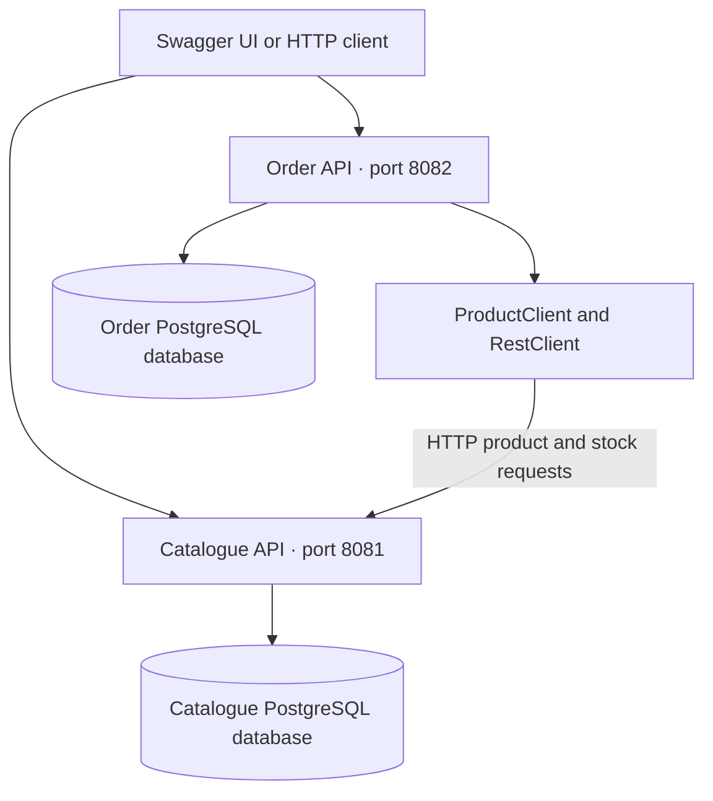
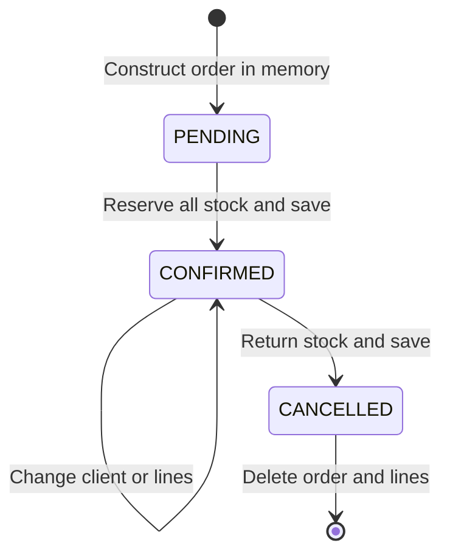
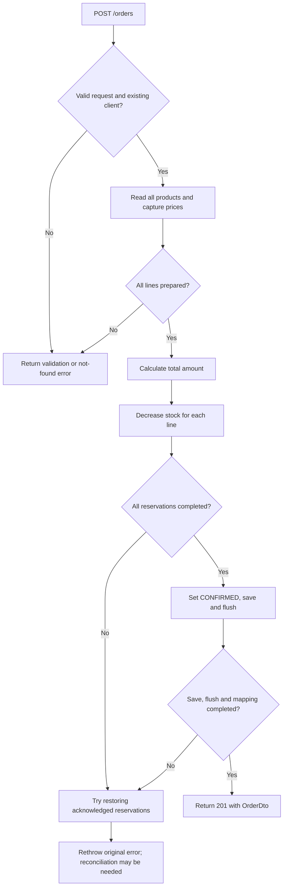
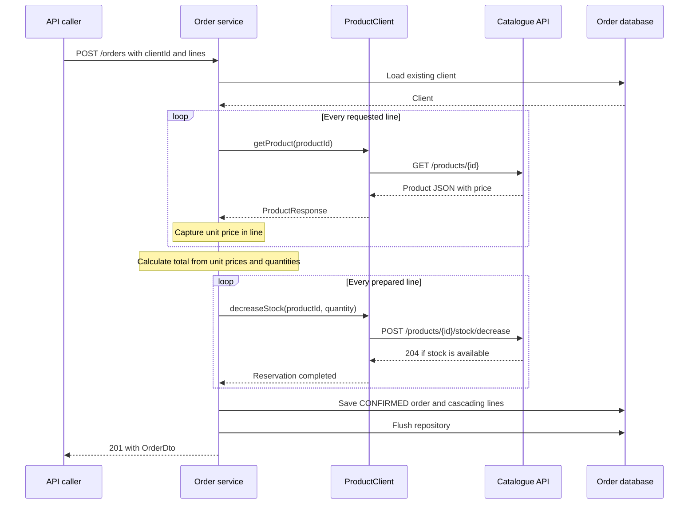
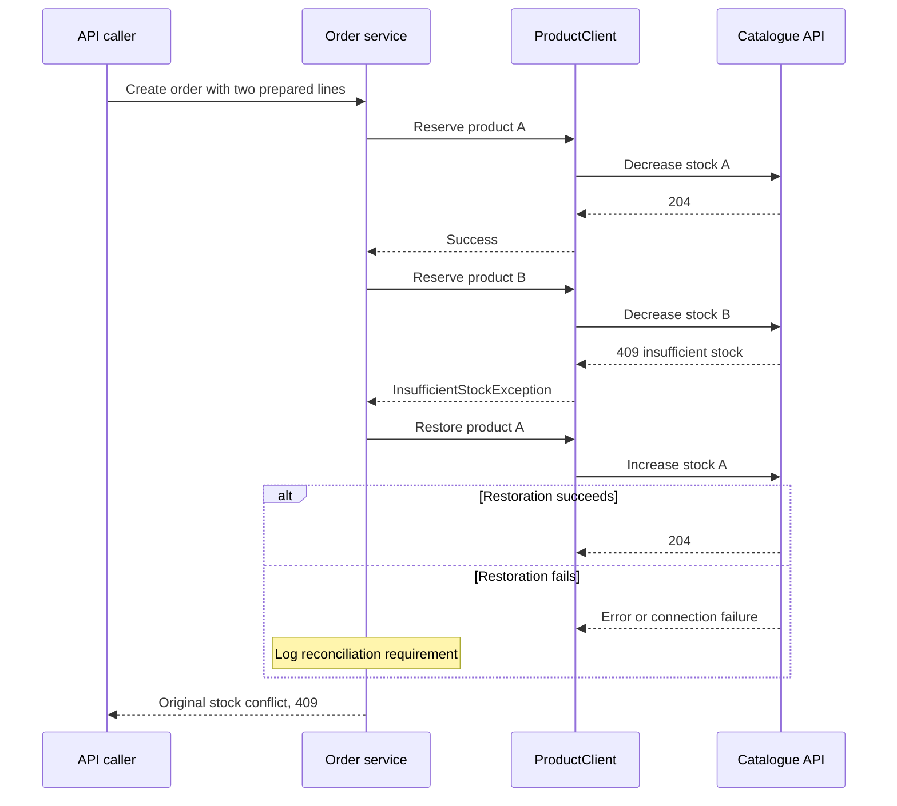
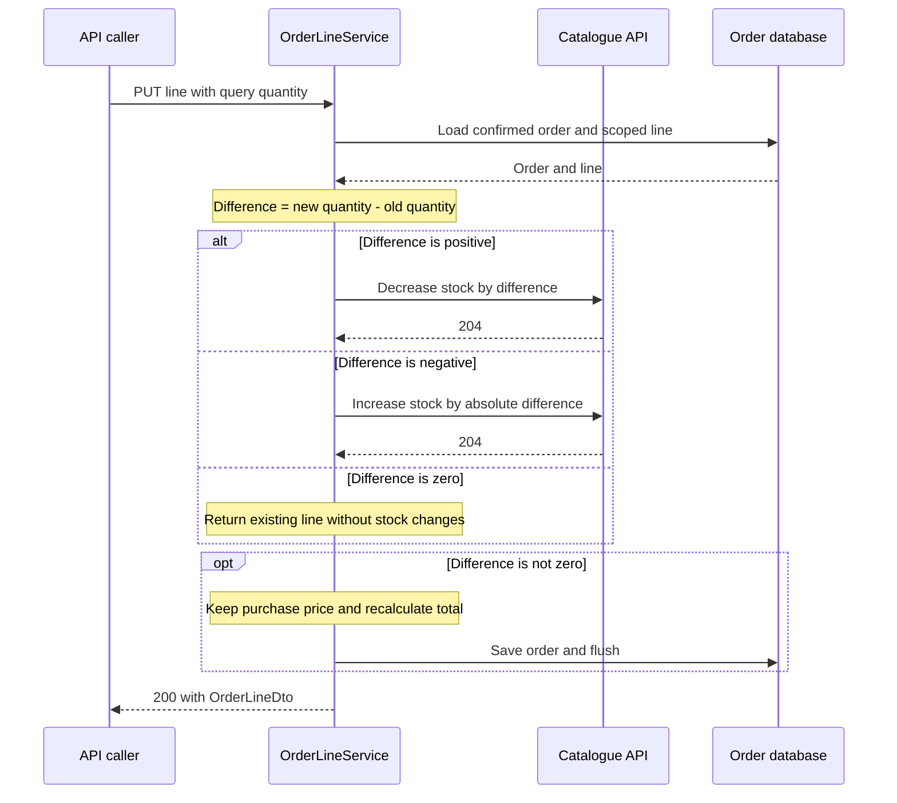
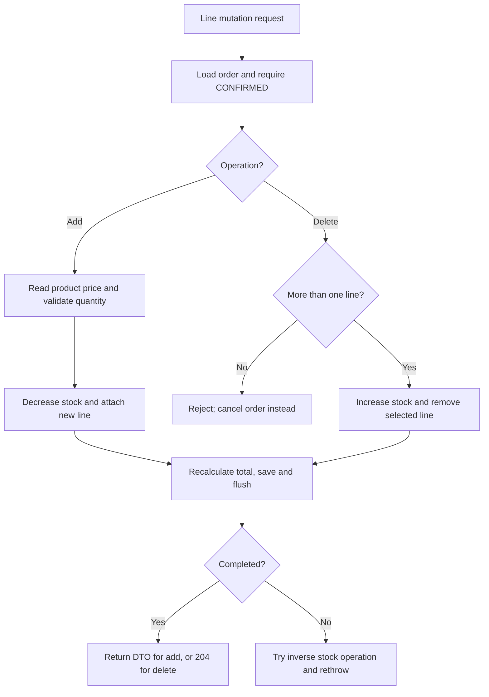
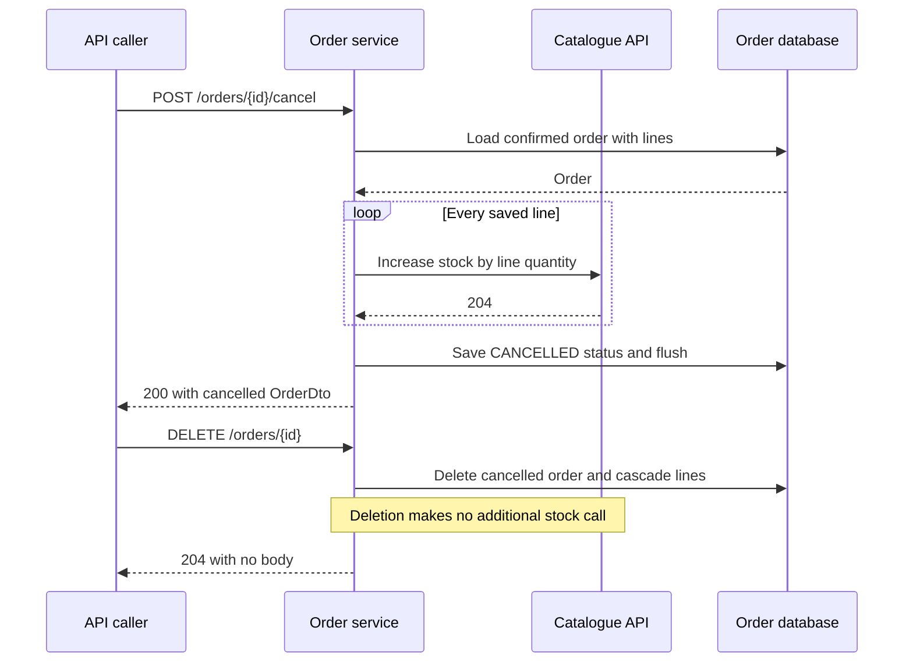
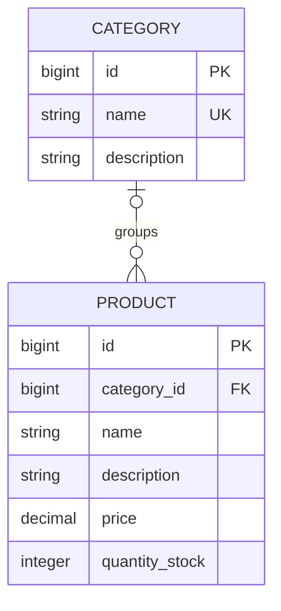
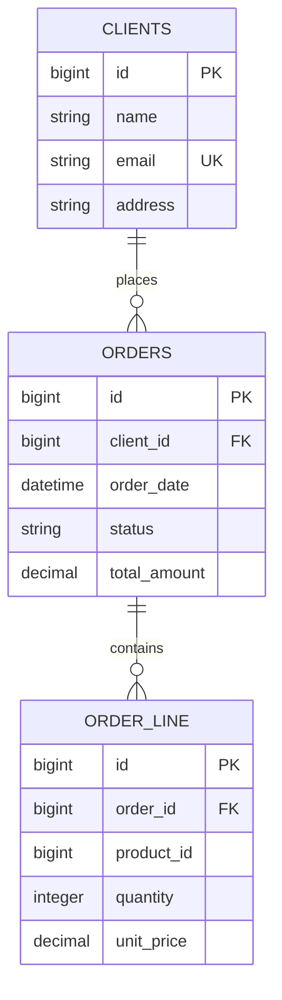

# Architecture, Flow and Sequence Diagrams

These diagrams describe the current source and intended successful operations. Database actions are shown separately from HTTP stock changes because there is no atomic transaction spanning both services. Order services currently have no service-level transaction boundary.

## System architecture

The order service reads product information through HTTP. It never joins its tables to the catalogue database. Each service contains its own controllers, services, repositories, DTOs and mappers.

## Order lifecycle

`PENDING` is the initial in-memory status during creation, not a separately saved draft exposed by a draft endpoint. Failure paths are omitted from this state diagram: compensation and persistence can fail, as described below. Cancelled orders cannot be updated through the order update method or have their lines changed.

## Create an order: decision flow

Only reservation calls that returned successfully are remembered for compensation. A timeout can still conceal a remote stock change. The flow does not imply that a later error rolls back an already committed local save.

## Create an order: successful sequence

The catalogue persists each stock operation in its own database, which is not shown as a sixth participant. Controller validation and DTO mapping are included within the order-service participant for readability.

## Partial creation failure: compensation

This specific sequence fails before saving an order. A save, flush or response-mapping failure can happen later and has different local persistence consequences. The compensation implementation is best effort, not a durable saga.

## Change an order-line quantity

ProductClient carries the HTTP requests but is collapsed into the catalogue interaction here. If saving or flushing fails after a stock adjustment, the service attempts the inverse adjustment and rethrows the error.

## Add or delete an order line

The delete lookup checks both line ID and order ID. Cascading persistence saves new lines; orphan removal removes deleted lines from the order database.

## Cancel and delete an order

If a stock return or local cancellation step fails, the service tries to reserve the units already returned. Repeated cancellation is rejected instead of returning stock twice. This successful sequence is not an idempotency guarantee for concurrent or retried requests.

## Database relationships

### Catalogue database

The entity mapping permits a null product category; the API requires categoryId and the service loads an existing category. The diagram shows the mapping's optionality rather than strengthening the SQL constraint beyond the code.

### Order database

`product_id` is deliberately not marked FK: its target is owned by the catalogue database. The API requires at least one line when creating an order, but the JPA relationship alone does not enforce that minimum as a database constraint.
