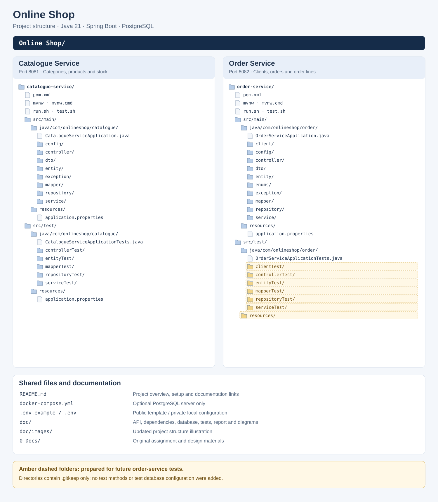

# Technical Documentation

This documentation describes the source code in this repository. It distinguishes implemented behavior from work that still needs testing or improvement. Examples use local development addresses and fictitious data.

| Document | Purpose |
| --- | --- |
| [Project report](PROJECT_REPORT.md) | Explain the assignment, implementation and current limitations |
| [API and Swagger guide](API_GUIDE.md) | Run requests through Swagger and understand HTTP responses |
| [Dependencies](DEPENDENCIES.md) | Explain the declared Maven dependencies and plugins |
| [Service communication](SERVICE_COMMUNICATION.md) | Explain calls between orders and catalogue |
| [Diagrams](DIAGRAMS.md) | Read architecture, state, flow, sequence and database diagrams |
| [Database](DATABASE.md) | Create local databases and understand the persistence model |
| [PostgreSQL with Docker](DOCKER_POSTGRES.md) | Start PostgreSQL and create databases manually |
| [Testing](TESTING.md) | Run existing tests and plan order-service tests |

## Project structure

Amber folders are prepared for future order tests and contain only `.gitkeep` placeholders.

## Suggested reading order

Read the root [README](../README.md) for setup, then the API guide for a practical scenario. Read the project report and communication guide to understand the design. Use the database and diagram documents when reviewing entity relationships and request flows.

Mermaid diagrams render directly in GitHub Markdown. They describe successful operations and explicitly marked failure paths, rather than claiming that distributed operations are atomic.

## Maintenance

Update the endpoint tables when controller mappings change. Update request examples when DTOs change. Update dependency tables from each `pom.xml`, and update the database guide when entities or relationships change. Record actual test execution results separately; test presence alone does not prove that a test suite passes.
